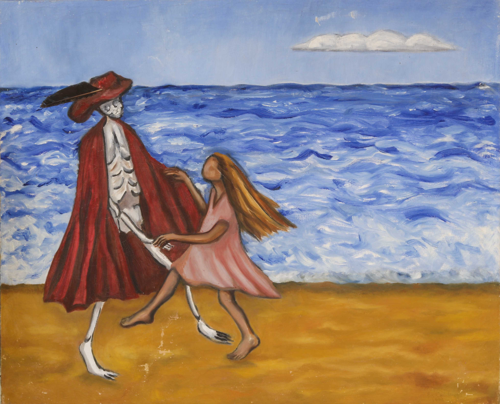

# Cecilia Amighetti Prieto — Memorial and Artistic Archive



A bilingual memorial website and digital archive for Costa Rican painter Cecilia Amighetti Prieto (1934–2016). It brings together a biographical tribute, a searchable collection of artwork, a career timeline, exhibition and press records, archival audio, and contact information for estate inquiries.

The site is a client-rendered single-page application. Its content and media are stored in the repository; it does not currently use a CMS, API, database, or server-side form handler.

## Features

- **English and Spanish:** The interface and editorial content are available in both languages.
- **Light and dark themes:** The initial theme follows the operating system unless a saved preference exists.
- **Artwork archive:** Browse 36 artwork records, filter by series, search titles and descriptive metadata in either language, and sort the results.
- **Artwork lightbox:** View artwork details, navigate between works, zoom and pan, and share artwork-specific pages through Bluesky, email, Facebook, LinkedIn, Telegram, or WhatsApp.
- **Biography and timeline:** Read the artist’s life story and career milestones; linked milestones and featured biography images can open related artwork.
- **Exhibitions and press:** Review exhibition records and selected press coverage.
- **Archival audio:** An optional audio player loads the recording from `public/audio/` and starts playback only after the visitor requests it.
- **Estate inquiries:** Open a pre-addressed email, optionally with an artwork in the subject, or copy the configured contact address.
- **Responsive layout and motion:** Layouts adapt to mobile and desktop. Motion effects are implemented with Motion for React.

## Technology

| Area                 | Technology                                                           |
| -------------------- | -------------------------------------------------------------------- |
| UI                   | React, TypeScript, Vite                                              |
| Styling              | Tailwind CSS v4, `tw-animate-css`, custom styles in `src/styles.css` |
| Animation            | Motion for React (`motion`)                                          |
| Icons                | Lucide React                                                         |
| Social sharing       | `react-share`                                                        |
| Build and type-check | Vite and TypeScript project build (`tsc -b`)                         |

Dependency versions are declared in `package.json` and resolved in `package-lock.json`. The project has `dev`, `build`, `preview`, `format`, and `format:check` scripts; no test or lint script is configured.

## Getting started

Install dependencies and start the Vite development server:

```bash
npm install
npm run dev
```

Format the project and sort Tailwind CSS classes with:

```bash
npm run format
```

Check formatting without changing files:

```bash
npm run format:check
```

Set the canonical production origin before building. It must be an absolute origin without a path, for example `https://example.com`:

```bash
export VITE_SITE_URL=https://your-domain.example
npm run build
npm run preview
```

The deployment environment must provide the same `VITE_SITE_URL` when it runs the build. The build fails if it is missing or is not a valid site origin. `npm run build` runs the TypeScript build first, then produces static files in `dist/`. Deploy the contents of `dist/` to a static web host.

The site remains a client-rendered single-page application. During the build, Vite also generates one static page per artwork at `dist/share/<artwork-id>/index.html`. Each page includes absolute canonical, Open Graph, and Twitter metadata, plus a link into the main app that opens that artwork. The share buttons use these per-artwork URLs. Social crawlers must be able to access the deployed pages and artwork images over the public HTTPS domain to build previews.

## Website structure

`src/main.tsx` mounts the React application into `#root` from `index.html`. The application is wrapped in `React.StrictMode`, `LanguageProvider`, and `AudioProvider`. `MainApp` in `src/App.tsx` composes the page in this order:

1. `HeroTribute` — introductory tribute and calls to the artwork archive and biography.
2. `BiographySection` — biographical chapters and linked artwork.
3. `GallerySection` — artwork filters, search, sorting, and cards.
4. `TimelineSection` — chronological milestones with optional artwork references.
5. `ExhibitionsSection` — exhibition records and press articles.
6. `EstateInquiriesSection` — contact details and inquiry links.
7. `Footer` — archive navigation and memorial information.

The artwork lightbox and floating audio player are rendered alongside the page sections so they can be opened from multiple areas of the site.

## Repository map

```text
src/
  App.tsx                         Application composition and page-level state
  main.tsx                        React entry point
  styles.css                      Tailwind import, theme variables, custom styles
  context/
    LanguageContext.tsx           Language and theme state
    AudioContext.tsx              Shared audio playback state and controls
  data/
    artworks.ts                   Artwork catalogue
    exhibitions.ts                Exhibition and press records
    timeline.ts                   Biographical timeline records
    translations.ts               English and Spanish UI copy
  types/
    index.ts                      Shared TypeScript data types
  components/
    audio/                        Floating archival audio player
    biography/                    Biography content
    common/                       Shared visual components
    exhibitions/                  Exhibition and press sections
    gallery/                      Gallery and artwork lightbox
    hero/                          Introductory tribute
    inquiries/                    Estate contact section
    layout/                       Navigation and footer
    timeline/                     Career timeline
public/
  artworks/                       Artwork JPEG files
  audio/                          Archival audio file
```

## Content and assets

### Artwork catalogue

Artwork records live in `src/data/artworks.ts` and conform to the `Artwork` interface in `src/types/index.ts`. Each record includes:

- A stable `id` and an image filename.
- English and Spanish titles, media descriptions, and curatorial stories.
- Year, series, orientation, and aspect ratio.
- Optional dimensions, signature notes, highlight status, and tags.

Artwork images are served from `public/artworks/`; the `image` field is a filename, and components construct URLs such as `/artworks/IMG_9367.jpg`. Keep filenames and records in sync when adding, replacing, or removing artwork. The same IDs can be referenced by timeline milestones and other featured artwork links.

Gallery filters use the `ArtworkSeries` values in `src/types/index.ts`. Search checks both language versions of titles, medium, stories, year, and tags. Sort options are implemented in `GallerySection.tsx`.

### Timeline, exhibitions, and press

- Add or edit career milestones in `src/data/timeline.ts`. An optional `artworkRef` links a milestone to an artwork ID.
- Add or edit exhibitions and press items in `src/data/exhibitions.ts`.
- Shared record shapes are defined by `TimelineMilestone`, `Exhibition`, and `PressArticle` in `src/types/index.ts`.

### Translations

The interface text is in `src/data/translations.ts`. `LanguageContext` supplies the active language and its translation object through `useLanguage()`.

On first visit, the application chooses English when the browser language starts with `en`; otherwise it defaults to Spanish. The selected language is stored in local storage as `cecilia_lang`. The language selector switches between `en` and `es` and updates the document's `lang` attribute.

When adding interface text, update both language objects and consume the translated value through the language context where practical. Artwork, timeline, exhibition, and press records likewise provide language-specific fields.

### Images, fonts, and audio

- Artwork JPEG files are stored in `public/artworks/`.
- The audio player loads `public/audio/cecilia-amighetti-canto.mp3`. It preloads metadata, starts playback only on user action, and keeps playback state in `AudioContext`.
- Fonts are loaded from Google Fonts in `index.html`; the stylesheet maps the chosen font families to editorial and utility classes.
- `CanvasTexture` adds a decorative SVG noise overlay and ambient background effects. It is visual decoration and does not contain application state.

## Application behavior and technical notes

### State and persistence

- `LanguageProvider` owns the current language and light/dark theme. It persists both in local storage (`cecilia_lang` and `cecilia_theme`); when no theme is saved, it reads `prefers-color-scheme`.
- `AudioProvider` owns the audio element and playback, duration, progress, volume, mute, and expanded-player state. Audio is off by default.
- `MainApp` owns the selected artwork and any artwork ID preselected for an inquiry.
- Gallery search, filter, sort, dropdown, and lightbox zoom/pan state are local to their components.

### Artwork lightbox

The lightbox is opened by selecting an artwork from the gallery or a linked feature. Previous/next navigation wraps around the catalogue. Keyboard controls include Escape to close, arrow keys to navigate, `+`/`=` and `-` to zoom, and `0` to reset zoom.

The social share buttons use `react-share` and share the generated `/share/<artwork-id>/` URL for the selected work. Each static page uses its artwork's English title, year, description, and image in its social metadata. Its “View artwork in the archive” link opens the main app with an `artwork` query parameter; `MainApp` reads that parameter to open the corresponding lightbox. Closing the lightbox removes the parameter.

### Inquiries

The inquiry area uses a `mailto:` link rather than submitting to a backend. The contact address is currently configured in both language objects in `src/data/translations.ts` under `inquiries.emailPlaceholder`. Update that value in both translations if the contact address changes. When an inquiry is started from the artwork lightbox, the selected artwork is included in the email subject and shown as context in the contact section.

### Styling and page metadata

Tailwind CSS v4 is integrated through the Vite plugin. `src/styles.css` imports Tailwind and `tw-animate-css`, defines the color theme variables, and contains custom visual effects. Components primarily use utility classes, with the `dark` class applied to the document according to the theme state.

`index.html` contains the root document's title, description, theme color, favicon, font preconnects, and font stylesheet. These values are static rather than generated per artwork or language.

## Configuration and limitations

- `vite.config.ts` configures React and Tailwind CSS and defines the `@` alias for `src/`.
- `tsconfig.json` enables strict TypeScript checking and maps the same `@/*` alias.
- `VITE_SITE_URL` is required at production build time to generate absolute share-page and image URLs.
- There is no backend, CMS, routing library, analytics integration, or automated test/lint command currently configured.
- The email contact link opens the visitor's configured mail application.
- Social share actions depend on the target platform and browser allowing a share popup or mail link. Some platforms cache Open Graph previews; changes to artwork metadata may not appear immediately after deployment.
- Google Fonts and social sharing destinations require network access.

## Deployment

[](https://app.netlify.com/projects/ceciliaamighetti/deploys)
